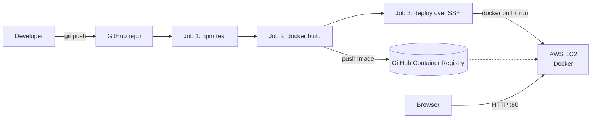
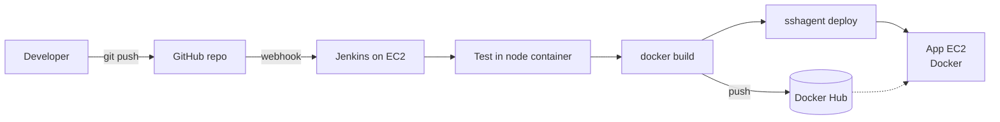

# AWS DevOps Demo: Node.js → Docker → Jenkins / GitHub Actions → EC2

The same app ships with **two CI/CD options**: a Jenkins pipeline (`Jenkinsfile`, Option B below) and GitHub Actions (`.github/workflows/deploy.yml`, Option A).


A small Node.js (Express) app that is **tested, containerized and deployed to AWS EC2 automatically** on every push to `main`.

## Architecture



## What this project shows

| Skill | Where |
|---|---|
| CI with automated tests | `test` job, `test/app.test.js` |
| Docker multi-stage build, non-root user, healthcheck | `Dockerfile` |
| Container registry | GitHub Container Registry (GHCR) |
| CD to AWS | `deploy` job: SSH to EC2, pull image, restart container |
| Post-deploy verification | Smoke test against `/health` |
| Secrets management | GitHub Actions secrets, no keys in code |

## Run locally

```bash
npm install
npm test
npm start                      # http://localhost:3000

# or with Docker
docker compose up --build      # http://localhost:3000
```

## Deploy to AWS (one-time setup)

### 1. Launch an EC2 instance
- AMI: **Amazon Linux 2023**, type: **t2.micro / t3.micro** (free tier)
- Key pair: create one and download the `.pem` file
- Security group inbound rules:
  - SSH (22) from **0.0.0.0/0** (GitHub runners use changing IPs; see "Hardening" below)
  - HTTP (80) from 0.0.0.0/0
- Advanced details → **User data**: paste `scripts/ec2-setup.sh` (installs Docker)

### 2. Add GitHub secrets
Repo → **Settings → Secrets and variables → Actions → New repository secret**

| Secret | Value |
|---|---|
| `EC2_HOST` | Public IPv4 address of the instance |
| `EC2_USER` | `ec2-user` |
| `EC2_SSH_KEY` | Entire contents of the `.pem` file |

### 3. Push to `main`
Watch the **Actions** tab. When it's green, open `http://<EC2_HOST>/`.
The page shows the commit SHA that's running, so you can see each new deploy.

## Option B: Jenkins pipeline (`Jenkinsfile`)

The same app is also delivered with a **Jenkins declarative pipeline**:
Checkout → Install & Test (inside a `node:20` container) → Build image → Push to Docker Hub → Deploy to EC2 over SSH → Smoke test.



### Jenkins setup
1. **Launch a Jenkins EC2** (Amazon Linux 2023, **t3.small** – Jenkins needs ~2 GB RAM). Security group: 22 from your IP, **8080** from your IP. Paste `scripts/jenkins-setup.sh` into *User data*.
2. Open `http://<jenkins-ip>:8080`, unlock with `sudo cat /var/lib/jenkins/secrets/initialAdminPassword`, install suggested plugins, then add **Docker Pipeline** and **SSH Agent**.
3. **Credentials** (Manage Jenkins → Credentials → Global):
   | ID | Kind | Value |
   |---|---|---|
   | `dockerhub-creds` | Username with password | Docker Hub username + access token |
   | `ec2-ssh-key` | SSH Username with private key | `ec2-user` + app server `.pem` |
4. Edit `DOCKERHUB_USER` and `EC2_HOST` at the top of the `Jenkinsfile`.
5. Create a **Multibranch Pipeline** job pointing at this repo (the `when { branch 'main' }` stages need multibranch).
6. Trigger builds on push: add a GitHub webhook `http://<jenkins-ip>:8080/github-webhook/` (port 8080 must also allow GitHub's webhook IP ranges), **or** simply set the job to *Scan by interval* / Poll SCM every few minutes.

The app server is the same as in Option A (`scripts/ec2-setup.sh`, port 80 open).

## Hardening ideas (next steps)
- Restrict SSH: use **AWS Systems Manager (SSM)** or **GitHub OIDC + IAM role** instead of opening port 22
- Put the app behind an **ALB** with HTTPS (ACM certificate)
- Provision the EC2 + security group with **Terraform** (see my Terraform project)
- Move to **ECS Fargate** for zero-downtime rolling deploys

## Cost and cleanup
Runs within the AWS free tier on a micro instance. When you're done:
**stop or terminate the EC2 instance** and delete the key pair to avoid charges.

## Screenshots
_Add these after your first successful deploy:_
- `docs/pipeline.png`: green GitHub Actions run
- `docs/app.png`: the app running at the EC2 public IP
