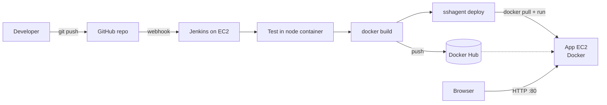
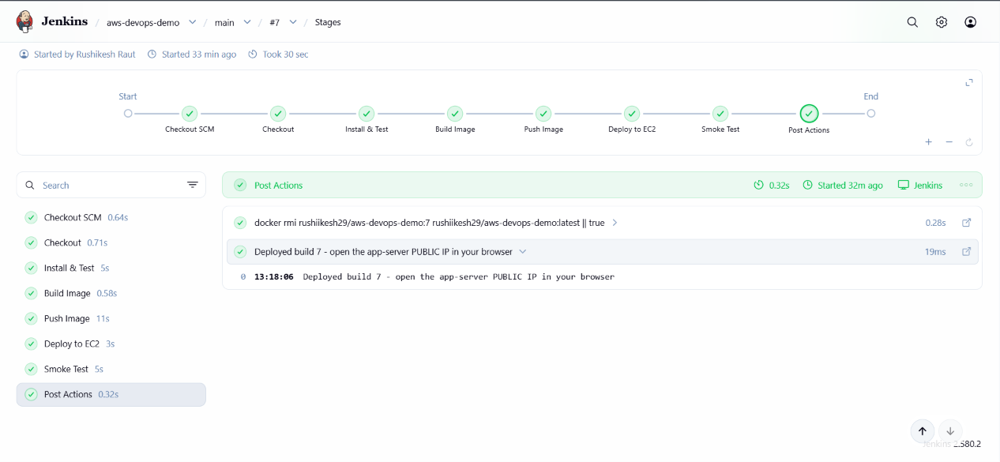
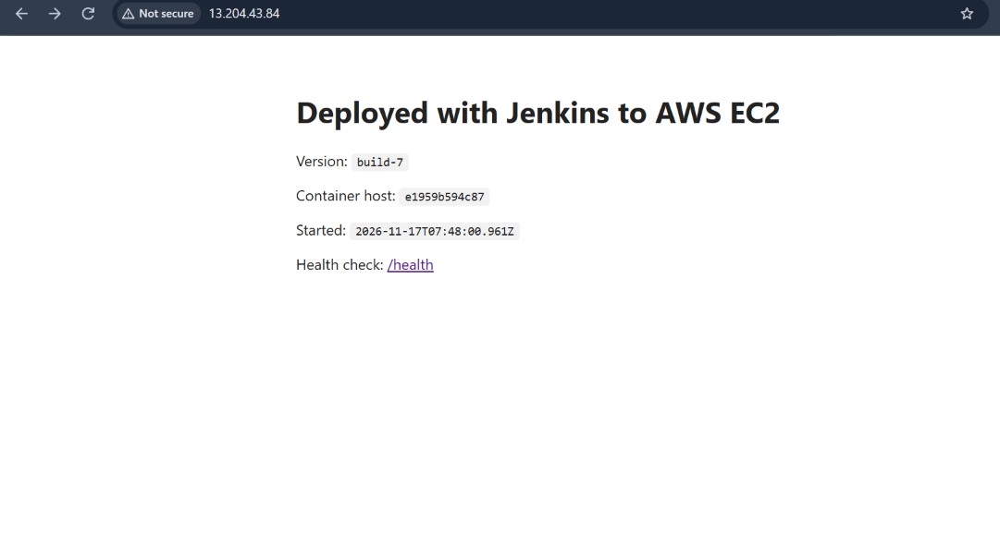
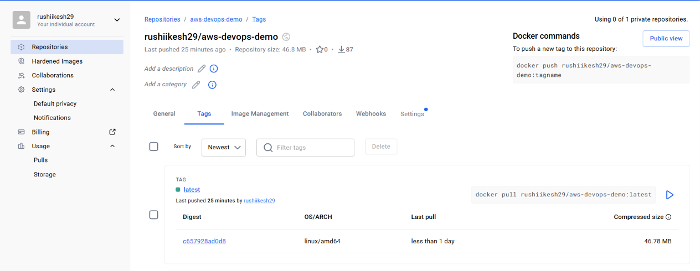

# AWS DevOps Demo: Node.js → Docker → Jenkins → EC2

A small Node.js (Express) app that is **tested, containerized and deployed to AWS EC2 automatically by a Jenkins pipeline** on every push to `main`.

## Architecture



Pipeline stages (`Jenkinsfile`): Checkout → Install & Test (inside a `node:20` container) → Build image → Push to Docker Hub → Deploy to EC2 over SSH → Smoke test.

## What this project shows

| Skill | Where |
|---|---|
| Jenkins declarative pipeline | `Jenkinsfile` |
| CI with automated tests | `Install & Test` stage, `test/app.test.js` |
| Docker multi-stage build, non-root user, healthcheck | `Dockerfile` |
| Container registry | Docker Hub (`Push Image` stage) |
| CD to AWS | `Deploy to EC2` stage: `sshagent`, pull image, restart container |
| Post-deploy verification | `Smoke Test` stage against `/health` |
| Secrets management | Jenkins credentials, no keys in code |
| Server provisioning | `scripts/jenkins-setup.sh`, `scripts/ec2-setup.sh` (EC2 user data) |

## Run locally

```bash
npm install
npm test
npm start                      # http://localhost:3000

# or with Docker
docker compose up --build      # http://localhost:3000
```

## Deploy to AWS (one-time setup)

### 1. App server (EC2)
- AMI: **Amazon Linux 2023**, type: **t2.micro / t3.micro** (free tier)
- Key pair: create one and download the `.pem` file
- Security group inbound rules:
  - SSH (22) from the **Jenkins server's security group** (or its IP)
  - HTTP (80) from 0.0.0.0/0
- Advanced details → **User data**: paste `scripts/ec2-setup.sh` (installs Docker)

### 2. Jenkins server (EC2)
- Amazon Linux 2023, **t3.small** (Jenkins needs ~2 GB RAM)
- Security group: 22 and **8080** from your IP
- **User data**: paste `scripts/jenkins-setup.sh` (installs Java 21, Jenkins, Docker, Git)

### 3. Configure Jenkins
1. Open `http://<jenkins-ip>:8080`, unlock with `sudo cat /var/lib/jenkins/secrets/initialAdminPassword`, install suggested plugins, then add **Docker Pipeline** and **SSH Agent**.
2. **Credentials** (Manage Jenkins → Credentials → Global):

   | ID | Kind | Value |
   |---|---|---|
   | `dockerhub-creds` | Username with password | Docker Hub username + access token |
   | `ec2-ssh-key` | SSH Username with private key | `ec2-user` + app server `.pem` |

3. Edit `DOCKERHUB_USER` and `EC2_HOST` at the top of the `Jenkinsfile`.
4. Create a **Multibranch Pipeline** job pointing at this repo (the `when { branch 'main' }` stages need multibranch).
5. Trigger builds on push: add a GitHub webhook `http://<jenkins-ip>:8080/github-webhook/` (port 8080 must also allow GitHub's webhook IP ranges), **or** set the job to *Scan by interval* every few minutes.

### 4. Push to `main`
Watch the build in Jenkins. When it's green, open `http://<app-server-ip>/`.
The page shows the Jenkins build number that's running, so you can see each new deploy.

## Hardening ideas (next steps)
- Put Jenkins behind HTTPS (Nginx + Let's Encrypt or an ALB) instead of exposing port 8080
- Use **Amazon ECR** with an IAM instance role instead of Docker Hub credentials
- Use **AWS Systems Manager (SSM)** instead of SSH for deploys
- Provision both servers with **Terraform**
- Move the app to **ECS Fargate** for zero-downtime rolling deploys

## Cost and cleanup
The app server fits the AWS free tier; the t3.small Jenkins server costs a few dollars a month.
**Stop the instances** when not in use, and terminate them (plus delete the key pairs) when you're done.

## Screenshots

### Jenkins pipeline: all stages green


### Live app on AWS EC2


### Image on Docker Hub

